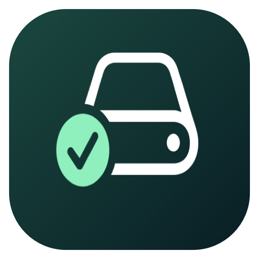

<p align="center"></p>
<h1 align="center">Reclaim</h1>
<p align="center">Room for your next build.</p>
<p align="center">macOS 13+ · SwiftUI + AppKit · MIT</p>

Reclaim is a native menu-bar storage utility for developers. Review everyday clutter, find build artifacts, and see Git worktrees across project folders, agent worktree locations, custom paths, and mounted disks. Cleanup is always a reviewed choice.

**[Download Reclaim for macOS](https://github.com/swlittles/Reclaim/releases/latest)** · [All releases](https://github.com/swlittles/Reclaim/releases) · [Source](https://github.com/swlittles/Reclaim)

Stable downloads are universal (Apple Silicon and Intel), signed with Developer ID, notarized by Apple, and include verified Sparkle updates. Open the DMG, drag **Reclaim** into **Applications**, then launch it from Applications. No Accessibility permission is required. Full Disk Access is optional for broader scan coverage.

## Use it

```sh
bash scripts/test.sh
bash scripts/build.sh
open "dist/Reclaim Dev.app"
```

Requires macOS 13+ and Swift 5.9 or newer with Apple's Command Line Tools. Build scripts resolve the pinned Sparkle package. The standalone core test runner does not require XCTest or full Xcode.

Click the drive in the menu bar to scan, review storage, or open Settings. The first launch opens the overview. Closing the window keeps the utility in the menu bar.

- **Quick Scan** inventories user caches/logs, Downloads, Trash, applications and exact bundle-ID cache/preferences data, device backups, Xcode artifacts, common developer roots and installed-tool worktree locations.
- **Add Folder** includes custom repository/worktree parents and mounted volumes. **Deep Home Scan** searches more accessible home folders with explicit traversal budgets. **Scan Added Folders Only** restricts the sweep to custom roots.
- **Worktrees** expands each discovered Git repository's registered family, even when linked paths live outside your scan roots. It shows main/bare/detached/locked/missing states and conservative removal blockers.
- **Developer Storage** finds evidenced SwiftPM, JavaScript, Rust and Python project artifacts, shared package stores, simulator/SDK inventory, local Docker objects, and VM storage.
- **Large Files** ranks large files and downloads. **Duplicates** groups candidates by size, verifies SHA-256 content, and requires keeping a copy.
- **Volumes** shows mounted capacity plus an optional read-only APFS layout report. Shared APFS free space is not additive.
- **History** records individual outcomes, Trash locations, non-overwriting restore, and Git safety refs.

Choose items, click **Review Actions…**, check exact paths and consequences, and apply the reviewed actions. Selection starts empty. Permanent actions need an extra acknowledgement. Each target is checked again before mutation. After cleanup a fresh scan is required.

## Protecting your work

Reclaim never force-removes a worktree. Main/bare roots, dirty/staged/untracked/ignored content, submodules, locks, in-progress Git operations, inaccessible state, detected active working directories, and commits without durable references block removal. A successful clean linked-worktree removal uses Git itself, keeps branches, and creates a safety ref for HEAD. This removes the folder permanently; a ref is not a file backup.

Docker volume removal is permanent and individual. Volumes referenced by stopped containers are protected too. Remote and unknown Docker endpoints are disabled. Shared cache pruning, simulator deletion, APFS erase/snapshots, and VM disk compaction are intentionally inventory-only in this version.

Moving to Trash generally frees no disk space until Trash is emptied. Allocated sizes are estimates: APFS clones, snapshots, hardlinks between separate findings, shared Docker layers, and concurrent writes limit exact attribution. Running-process checks are best effort. See [Safety](SAFETY.md) for boundaries and residual filesystem races.

## Local by default

No account or analytics. Optional release update checks connect to GitHub through Sparkle. Metadata and cleanup history stay under `~/Library/Application Support/Reclaim Dev/` (or `Reclaim/` for production), with owner-only permissions. Full Disk Access is optional and cannot overcome Unix permission limits or disconnected storage. See [Privacy](PRIVACY.md).

## Development and releases

Local builds are **Reclaim Dev**, with a separate bundle ID, preferences, local data, DEV icon and no updater initialization/feed. Universal build:

```sh
RECLAIM_UNIVERSAL=1 bash scripts/build.sh
```

The release pipeline follows [Bustelo](https://github.com/swlittles/Bustelo) and [Snippet](https://github.com/swlittles/Snippet): universal app, Developer ID, hardened runtime, notarization/stapling, DMG, ZIP, checksums, signed Sparkle feed/archive, and gentle menu reminders. Reclaim has its own update-signing key. Apple signing and notarization use the same developer identity as the owner’s other Mac apps. Stable builds fail if required signing, notarization, or update configuration is missing.

- [Development](docs/DEVELOPMENT.md)
- [Architecture](docs/ARCHITECTURE.md)
- [Release engineering](docs/RELEASING.md)
- [Implementation plan](docs/IMPLEMENTATION_PLAN.md)
- [Validation and current limitations](docs/VALIDATION.md)
- [Contributing](CONTRIBUTING.md), [Security](SECURITY.md), [Changelog](CHANGELOG.md)

MIT. Includes Sparkle (MIT); see [third-party notices](docs/THIRD_PARTY_NOTICES.txt).
